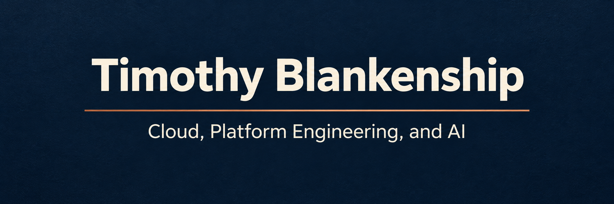

# Timothy Blankenship

Cloud, Platform Engineering, and AI

I've spent more than 25 years in IT, from systems administration and engineering to leading cloud and platform teams. I still like understanding how things work. These days, much of my work is making sure the technology, the team, and the business are moving in the same direction.

My experience spans cloud migrations, building DevOps teams, managing service providers, and negotiating multimillion-dollar contracts. My responsibilities include cloud infrastructure, platform engineering, a Cloud Center of Excellence, and FinOps.

## How I Approach the Work

I believe teams should have a straightforward way to get things done. Self-service automation should make routine infrastructure work easier, and governance should give people a clear path forward.

I encourage experimentation. Things will break, and how we respond matters. I expect us to learn, make the necessary changes, and follow through.

Moving from engineering into leadership taught me that knowing the technology is only part of the job. Helping people succeed takes its own effort and attention. That has been some of the most challenging and rewarding work of my career.

## Enterprise AI Field Guide

I'm sharing practical perspectives on designing, building, and operating AI in the enterprise. The guide connects technology with ownership, cost, security, reliability, and the people responsible for the outcome.

[Read the Enterprise AI Field Guide](https://github.com/timothyblankenship/enterprise-ai-field-guide)

## Outside the Day Job

I'm an Air Force veteran who served as a satellite systems operator with USAF Space Command. I still enjoy building things, although these days that often means space-themed LEGO sets. I also appreciate a good laugh, including at my own expense.

[Connect with me on LinkedIn](https://www.linkedin.com/in/blankenshiptim)
